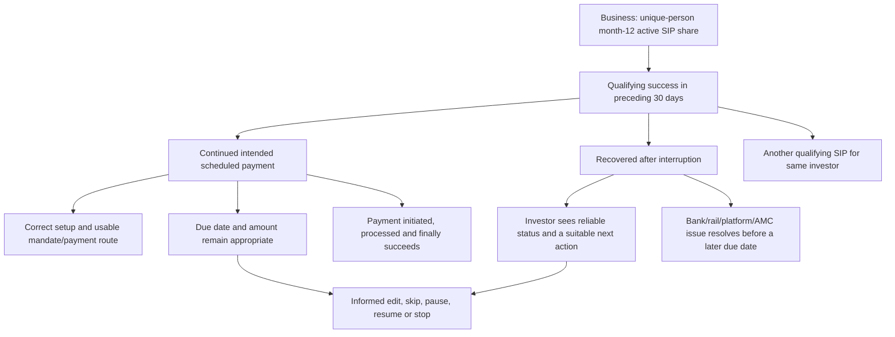

# Part 2 — SIP continuation metric, system, and first research decision

**7 November 2026 IST · Research artifact 1 · Status: metric reasoning complete; opportunity choice open.** This is the first step of [the remaining-project research plan](REMAINING_PROJECT_RESEARCH_PLAN.md). It reuses the original brief, the dated [problem map](research/PROBLEM_MAP_AND_FIRST_DECISION.md), the [nine-question audit](research/NINE_QUESTION_EVIDENCE_AUDIT_2026-11-04.md), and the 6 November public discovery-engine snapshot. I reopened two original Groww help pages on 7 November; forum claims below remain **engine proposals**, not newly verified original posts. No Groww internal data, new interview, or causal test was used.

## 1. Decision this research serves

**Business aim:** increase the percentage of first-time mutual-fund investors who still have an active SIP 12 months after starting their first one. **Brief definition of active:** at least one successful instalment in the preceding 30 days. The user-benefit aim is narrower than “maximize payments”: help an investor understand and carry out an *intended and affordable* choice. An informed pause or reduction can be right for the person even if it does not improve the company metric.

**Question now:** which first-year transition could Groww plausibly improve, and what evidence would distinguish an unwanted interruption from an appropriate change or an upstream failure? This step chooses the **next research question**. It does not yet choose a target segment, root cause, or MVP.

**Strategy:** improve the reliability and clarity of an investor's chosen recurring-investment journey where Groww has a real role. This is a project strategy hypothesis, not a claim about Groww's published corporate strategy. The causal chain to test is `clear and workable intended action → appropriate payment/adjustment outcome → possible month-12 qualifying success`. The first arrow can be tested with an episode or task; the final arrow needs longitudinal, person-level Groww data. A functioning app screen or positive reaction cannot bridge that gap by itself.

## 2. KPI tree: exact arithmetic versus possible levers

### 2.1 North Star measurement contract

Let **N** = unique eligible first-time MF investors whose 12-month checkpoint has matured; **A** = those with at least one *qualifying successful SIP instalment* in the last 30 days; **I** = those confirmed without one; **U** = those whose status or coverage is unresolved. Then `N = A + I + U`. The confirmed-active lower bound is `A/N` and, if every unresolved person could potentially qualify, the upper bound is `(A+U)/N`. Do not drop U or silently count it inactive. N, A, I, U and the baseline are all **unknown from public sources**.

One person counts once even if they own several SIPs, retry several payments, or invest more rupees. An SIP instruction that says “active,” a bank debit, a holding balance, a one-time purchase, a forum post, and an app visit are **different units/events**. Whether a recovered manual payment qualifies as SIP-linked and which final status counts as “successful” require Groww data-owner definitions. The [current Groww help page on an incomplete order](https://groww.in/help/mutual-funds/order/why-is-my-sip-order-not-completed-1) says a debit can precede a processing period and points to an expected completion date; therefore debit alone is not a safe proxy for completed investment. This documentation establishes possible states, not their frequency or user interpretation.

For people with fully observed outcomes at month 11 and month 12, define four mutually exclusive cells: **a** active at both; **b** active at 11 only; **c** active at 12 only; **d** inactive at both. `N_observed = a+b+c+d`; `A12_observed = a+c`; change in active share across those checkpoints = `(c−b)/N_observed`. This cleanly separates **continuation** from **recovery**. It is an identity, not a measured Groww result. Missing and not-yet-matured people sit outside this fully observed transition calculation and must be disclosed. Overlapping 30-day windows can also affect interpretation of a “monthly” change.

### 2.2 Influence tree, not a multiplication of assumed conversion rates

This is a **system map of possible influences**, not an additive partition or proof that any lever has a large effect. The arrows can interact: a person may recover one SIP, keep another, or stop an amount that is no longer affordable. “Improve control use” is not the same as “make continuation harder to exit.” At the month-12 window, another successful SIP for the same person already satisfies the numerator; repairing one failed instalment may improve experience but add **zero** to this metric if the person already qualifies. We must preserve both user value and incremental metric effect.

### 2.3 Diagnostic KPIs and what each can answer

- **Eligible setup completion:** unique eligible starters with a usable SIP/mandate setup divided by unique eligible first-SIP starters. It locates setup friction, not a cause of month-12 inactivity. Need the exact start and usable-setup events.
- **Intended due-payment initiation:** due instalments attempted divided by due instalments *the investor intended to pay*. Intent is rarely in logs, so a practical logged “all due” rate and a separately studied intent classification may be needed. Do not silently remove skips from a denominator.
- **Payment final success:** distinct due instalments with a final qualifying success divided by distinct attempted due instalments; retries link to the same due ID. Split failures by verified stage and actor where possible. This is an instalment rate, not a person retention rate.
- **Recovery:** unique investors with a final qualifying success within a defined window after an **unwanted** interruption divided by unique investors with that defined interruption. Specify the window and how intent is known. A later one-time investment is not automatically recovery of the scheduled SIP.
- **Informed adjustment success:** people who complete their intended amount/date/skip/pause/stop change correctly divided by people who attempted that change. Record mistaken or unwanted debit as a harm guardrail. A correctly executed pause can lower the North Star while improving welfare.
- **Month-11-to-12 continuation and return:** `a/(a+b)` and `c/(c+d)` in the fully observed subset. These are diagnostic transition rates; neither alone equals A/N for the full matured cohort.
- **Final business outcome:** A/N with N and U explicit. All these Groww rates are **unmeasured in this project**. A click-through rate, support click, explanation read, or app open is a *diagnostic*, not a substitute for a successful instalment.

**Data-owner request if access exists:** person-level eligibility and first-ever MF/first-SIP fields; start/checkpoint clock; SIP and due-instalment IDs; payment route, mandate and verified failure stage; init/debit/processing/allotment/reversal timestamps; skip/edit/pause/cancel/resume; one-time-payment linkage; other SIPs; completeness and migration flags. Request a mature cohort and month-by-month person-state transitions by stated, privacy-safe cuts. Without these, the tree stays a causal map rather than an estimated loss waterfall.

## 3. Systems thinking: who can influence what?

The **investor** chooses purpose, amount, date, whether to continue and whether to seek help. Money availability and obligations exist outside Groww. **Groww** can influence setup, in-app meaning, status visibility, control findability, guidance and support hand-off; it cannot unilaterally make a bank debit succeed. **Bank and payment/mandate rails** can affect authorization, balance and debit execution. **Order-processing rails, AMC and registrar** affect later processing and allotment state. A generic “SIP failed” label collapses these stages and can falsely blame Groww or the investor. The [Groww failure-help page](https://groww.in/help/mutual-funds/order/why-did-my-sip-installment-fail--36), checked 7 November, lists KYC/detail, payment/mandate, and scheme restrictions as possibilities. It does **not** reveal which reason dominates this cohort or whether an individual failure had that cause.

**Jobs to be Done lens:** the investor “hires” the recurring arrangement to make progress toward a stated goal with manageable effort and risk. The job may shift with income, obligations or learning. A useful experience helps them *know what happened and choose what fits now*; it does not assume every stop is a defect. This is a research framing, to be tested with first-hand accounts, not a population finding.

**Impact map:** investor progress → correct understanding/action → final contribution or informed adjustment → possible person-level month-12 outcome → longer-term relationship/business value. Each link needs different evidence: first-person chronology for meaning, observed tasks for comprehension, event logs for payment success, cohort data for the North Star, and an experiment or credible comparison for incremental effect. Company revenue or industry SIP volume is context, not a value calculation for this intervention.

## 4. Discovery-engine evidence: what it suggests and what it cannot settle

The [public discovery engine](https://sip-research-viewer.soumyasantra431.workers.dev/) has nine Fellow-endorsed **provisional** question readings and four unscored leads. Its 6 November snapshot has **zero source-level accepted records and zero approved answers**. Counts here are *locally usable assistant-proposal source roots per lead*, not unique investors, Groww incident rates or human-verified findings. The same root can support more than one lead; do not add lead counts into a total. The 932 retrieved app-review IDs are collection volume, not 932 analysed SIP investors, and do not support the nine answers.

- **Initial-payment/next-date meaning:** 1 proposed root, 0 confirmed target records. [Adjacent or eligibility-unknown forum account](https://tradingqna.com/t/sip-cancel-on-mf/190338/1) is summarized in the engine as an initial buy cancelled while the next payment was unclear. We did not re-open the original forum page in this step. **Missing:** later scheduled payment, first-year Groww eligibility, adverse consequence. **Rival:** normal learning or intentional initial-order cancellation.
- **Intended-payment interruption/recovery:** 3 distinct proposed roots from 4 proposal records, 0 confirmed target records. The engine points to adjacent-platform mandate/payment-route reports, including a [Coin follow-up](https://tradingqna.com/t/peculiar-payment-problem-in-coin/156840/9). The reported workaround does not verify a later scheduled SIP payment. **Missing:** Groww case, verified actor, next due-date outcome. **Rival:** bank/mandate condition or ordinary processing.
- **Pause/delete/cancel meaning:** 3 proposed roots, 0 confirmed target records. The engine's [forum lead](https://tradingqna.com/t/delete-option-in-sip-conditional-order-in-coin/96985/1) describes a reported accidental deletion after a pause; future contribution consequences are unknown. **Missing:** present Groww control behaviour, investor intention and next payment. **Rival:** a correctly working control and precautionary question.
- **Trust/support:** 2 proposed roots, 0 confirmed target records. The proposal concerns support or control uncertainty on adjacent platforms. **Missing:** whether support caused a changed payment choice. **Rival:** unrelated circumstance or a valid pause.

**Research priority, not product priority:** the common discriminating gap is a **direct first-year Groww episode with stated payment intent and the next scheduled result**, paired with a continuer or successful adjuster facing a comparable difficult month. That one contrast can separate “execution blocked,” “status misunderstood,” “informed pause,” and “no meaningful loss” better than more isolated complaint mentions. It cannot estimate how common any route is. The four leads remain alive until this contrast or a target-cohort event cut changes the comparison.

## 5. Next decision test and tools selected for it

Use a **semi-structured chronology interview** (or an interactive written exchange with follow-up) because intent, interpretation and off-app actions are missing from the public records. Start openly with the first SIP and what happened through the latest due date, including ordinary months. Only then probe a specific change or difficult month *if the person reports one*: original SIP job/expectation → intended action → app/bank signal → interpretation → inside/outside action → immediate result → next scheduled payment → whether the result served their goal. This guards against recruiting only payment-problem stories. Compare an interrupter and continuer on the same broad event type when possible, but preserve unlike cases instead of forcing a match. Do not teach respondents our four lead names. Add a safe **task observation** only if the story points to a particular Groww status or control: ask the person what it means and what they would do, without placing a transaction. Consult the official product flow to distinguish available, findable, understood and reliable. Ask a Groww data owner for cohort rates only if access becomes available; interviews cannot replace that denominator.

The planned 5–6 target interviews should include people who continued through a comparable difficult month, not only posters who report trouble. This is **contrast sampling for mechanism discovery**, not a representative survey. A user persona at this stage is a *provisional situation profile* with stated goal, constraints, trigger, workaround and outcome; do not invent age, income or a fictional quote. A journey map uses actual reported/observed episodes and marks missing stages. Design thinking's “understand → define → explore → test” order is useful here, but none of its labels is evidence by itself. Growth-loop, positioning and A/B-test methods become useful only when we have a chosen intervention and a measurable feedback path; an A/B test of a two-day prototype cannot observe a 12-month outcome by the project deadline.

**Hypothesis to investigate, not finding:** for some first-year Groww investors who *intend* to pay, unclear status after a due date may delay a useful recovery action. Prediction: they misread the state before acting, and a clearer explanation changes their understanding or next action. Rival prediction: they read the state correctly but an upstream mandate/bank condition still prevents payment. A third possibility is no unwanted loss because payment later settles. Record the next due-date outcome and actor evidence before claiming a cause. A continued investor with the same ambiguous status is a required counterexample.

**Stop/reversal:** if direct episodes show that payment/status understanding was correct and the issue lies solely upstream, stop framing a Groww explanation as the remedy; investigate only whether Groww can improve diagnosis or hand-off. If the pause was wanted, do not try to prevent it. If an existing control works when found, test discoverability before a new feature. If none of the first-hand cases establish an ending, keep the hypotheses open and test safe comprehension tasks; do not manufacture a root cause. At the next checkpoint, compare four source-linked evidence cards on user consequence, target fit, actor control, rival and feasible test before choosing a segment.

## 6. PM decision log for this step

- **Decision:** freeze the person-level metric and a reversible state/influence tree; use the engine's four leads to ask a discriminating next-payment question. **Why:** the brief requires an outcome chain, but the public corpus cannot supply person-level rates or intent.
- **Alternative deferred:** rank the largest complaint cluster or choose an AI status feature now. **Why deferred:** no confirmed target records in the four engine leads, unreviewed source proposals, unknown next scheduled outcomes and unknown reach.
- **Current certainty:** high for the brief's metric wording and the arithmetic identities; high for what Groww's checked help pages document; limited for the source-attributed forum summaries; unknown for first-year Groww prevalence, dominant cause, tractability and month-12 lift.
- **Reversal condition:** a direct target-fit episode or valid cohort data reveals a different high-consequence transition, a wanted pause, an already-working control, or actor responsibility outside Groww. Update the tree and opportunity comparison rather than fitting the new fact to the current hypothesis.

**Next research artifact:** four equally structured evidence cards, after original-source review, plus a screening/neutral interview guide. Only after that comparison do we make a provisional segment decision. The separate AI-native MVP, three-user task test, golden-set quality log, 10-slide deck and deployed link remain later deliverables.
