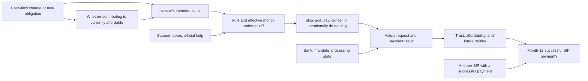

# From the 12-month metric to a problem worth testing

> **Historical checkpoint.** This cash-flow-adjustment problem gate was revised later on 7 November after stronger direct Groww accounts of intended-payment interruptions. See [current provisional problem definition](PART4_PROVISIONAL_PROBLEM_DEFINITION_2026-11-07.md). Its informed-pause counterexamples remain guardrails.

**7 November 2026 IST. Status: bounded public-source research and PM decision, not a validated root cause, interview study, or projected retention lift.** Read with the [person-level metric decomposition](PART2_METRIC_SYSTEM_AND_FIRST_RESEARCH_DECISION_2026-11-07.md), [behavioral segment comparison](PART3_BEHAVIORAL_SEGMENT_DECISION_2026-11-07.md), and [current documented-flow/static-guide check](PART4_CURRENT_FLOW_AND_STATIC_BASELINE_2026-11-07.md). The discovery engine was used to locate starting questions; the newly inspected public accounts below were manually read from their original pages and **not** counted as engine-analysed rows. Only links and paraphrases are retained; no usernames, ages, amounts, screenshots, or account details.

## The outcome we are working backwards from

The **business outcome** is a higher share of unique first-time MF investors who began their first SIP on Groww and have at least one successful SIP instalment in the preceding 30 days at month 12. `N = A + I + U`: eligible investors equal confirmed active, confirmed inactive and unresolved, as defined in the metric document. All four values and the baseline are unavailable publicly. A person with another successful SIP may already be in `A` even if one plan is stopped. The **user outcome** is a choice they understand, can afford and can carry out—including a pause. These outcomes can diverge.

**Decision this research serves:** Is the previously selected “cash-flow adjuster” situation a true *unwanted* continuation problem, or is it often an informed adjustment? What product outcome can Groww plausibly improve without pushing an unsuitable contribution? This is a choice of problem to test, not a request to maximize activity in every circumstance.

## Why these sources and what they actually establish

1. **Before an action:** A [Groww user a few months into SIPs](https://www.reddit.com/r/MutualfundsIndia/comments/1h4t6nw/) expects higher expenses and asks how to pause and whether a penalty applies. **Public user account; direct platform, first-year SIP timing stated; first-ever MF and later action/outcome unknown.** This establishes a decision moment, not failed continuation.
2. **An adjustment that appears to preserve the routine:** A [different Groww user](https://www.reddit.com/r/IndianStockMarket/comments/1hcgq2k/) reports having skipped a November instalment and **paid December**, then asks about January. In replies they say they will instead **reduce the SIP amount for two months**. **Public user account; direct platform, first-ever MF and month-since-first-SIP unknown.** The paid December is a stated **one-month result**, not verified by transaction records or proof of month-12 activity. This account is a counterexample to “skipping means the investor stopped”; it also shows that a user can shift from skip to amount edit as the situation evolves.
3. **Near-due inability to change:** A [public writer with several SIPs](https://www.reddit.com/r/MutualfundsIndia/comments/1izbcws/) says an upcoming instalment is already processing and the skip option cannot affect it within two working days. A later reply says they expect to pay this time. **Public user account; platform, first-ever MF, actual debit result and later SIP status unknown.** It illustrates a possible timing mechanism, but cannot be counted as direct Groww or a verified payment. The writer also considers stopping one specific plan for a separate preference; that is not evidence of whole-person inactivity.
4. **Expense shock and processing uncertainty:** A [different public investor](https://www.reddit.com/r/MutualfundsIndia/comments/1h7blc6/) describes higher-than-expected home expenses and says the SIP is already processing, so a skip cannot be made. **Public user account; platform and first-year eligibility unknown; next payment unknown.** Other commenters offer different predictions about penalties and resumption; their assertions are **not** treated as Groww rules or the writer's outcome.
5. **Existing product rules:** [Groww's Skip help](https://groww.in/help/mutual-funds/mf-sip/how-to-skip-an-sip-instalment--79) says a near-due request may affect a later instalment and three consecutive skips/misses cancel the SIP. [Groww's pause steps](https://groww.in/help/mutual-funds/order/can-i-pause-sip-for-next-month) tell the person to check the **month displayed at confirmation**. [Edit help](https://groww.in/help/mutual-funds/discoverable/when-can-i-edit-my-sip--29) says amount/date changes within two working days apply later. **Company-reported capabilities/rules, not evidence that any writer saw or understood them.** Public help's “two days” versus “two working days” wording remains a precision limit; account-specific dates cannot be predicted from these pages alone.

The first two Groww roots are **two different writers**, and the latter two are **two adjacent/unknown-platform writers**. These four selected roots are deliberately searched contrasts, not a denominator of Groww investors. The original-checked Groww Play review about an attempted skip amid income disruption remains a separate short direct-platform signal in the earlier [behavior comparison](PART3_BEHAVIORAL_SEGMENT_DECISION_2026-11-07.md); it cannot supply a next scheduled outcome. No source here establishes the brief's full first-time-MF + first Groww SIP + known month-12 state.

## System map: effects beyond the next button click

These paths are **PM hypotheses** unless a source above supports a particular step. They are not observed conversion funnels.

**First-order effect:** a clear route can change what the investor expects the *next* instalment to do; an effective request can avoid an unwanted debit or an unintended miss. We have product rules, but no observed target-user task success.

**Second-order effects:** an informed skip may reduce successful payments this month yet preserve autonomy and avoid a failed debit; an informed amount reduction may preserve an affordable routine; an ineffective late request may create surprise, support demand or a bank/mandate problem. The Groww counterexample reports a skipped month followed by a paid month and a planned reduction, but does not prove why that happened or how long it lasted. A reminder that pressures payment could have the opposite of the intended user benefit. These are plausible consequences, not measured effects.

**Third-order effects:** repeated clarity or confusion might change trust and later contribution behavior, eventually affecting month-12 activity; three consecutive skipped/missed instalments can cancel the plan under Groww's documented rule; a one-time catch-up payment may not repair the next automatic debit; a person with multiple SIPs may remain active regardless. The direction and magnitude of these later effects are **unknown** without person-level follow-up. A higher short-term payment count may even mask unaffordable behavior or unwanted bank failures. Do not use “continue at all costs” as a product strategy.

## Rival explanations and the observation that separates them

- **H1: unclear effective month.** The person wants to adjust, but predicts that Skip/Edit changes the upcoming due payment when Groww will apply it later. **Observable if true:** their prediction conflicts with the displayed confirmation before we teach the rule. **Rival:** they understand the rule and are simply asking a cautious question. **Test:** ask for their prediction from a non-transactional current screen, then compare with the actual confirmation month. No real target-user test has done this yet.
- **H2: control or processing constraint.** The person understands the effect but the request is too late, unavailable for their route or already processing. **Observable if true:** correct understanding, but disabled/ineffective control and a stated reason in the live flow. **Rival:** the option was available and the question was about affordability. **Test:** inspect a permitted live SIP/mandate route or official support state; do not infer from a general help page or enter financial data.
- **H3: informed financial choice.** A new obligation makes a pause or reduction appropriate; the product should help enact it without pressure. **Observable if true:** the person can explain the tradeoff, chooses it after seeing clear options, and regards the result as intended. **Rival:** they would have preferred a smaller or later contribution but misunderstood a feasible control. **Test:** neutral first-hand chronology and task, not a leading “would you continue if...” question. Simulated fixtures cannot answer this.
- **H4: payment execution independent of choice.** The bank, mandate or processing rail stops an intended payment despite the investor understanding the control. **Observable if true:** clear intent and correct comprehension, but confirmed external/system failure. **Rival:** a payment was never due or the investor intentionally skipped. **Test:** verified status and next scheduled payment, with actor attribution. Public posts generally lack this.

## PM decision and product-outcome chain

**What changed:** the selected behavioral group still has a real *decision moment*, but the new Groww counterexample means “skip or reduction = churn” is untenable. We also cannot frame the root cause as a missing control. The best provisional problem to test is narrower:

> For a first-year Groww SIP investor whose cash-flow circumstances have changed, the immediate job is to understand **which contribution an adjustment will affect** and complete an informed choice before assuming the next debit will change. Some users may be too close to the due date or may intentionally pause. We do **not** yet know whether misunderstanding causes an unwanted missed payment for the brief's target cohort.

**Product outcome to test first:** correct understanding of the effective instalment **and** an intent-aligned action, including “pause” or “seek official support.” Count unique people completing a real task, not button clicks or answer length. This is a prerequisite behavior, not proof of the business outcome. Then, if internal data or consenting follow-up ever exists, observe whether a request processed as intended, whether the next due instalment succeeded, and whether the unique person qualifies at month 12. The [metric audit](PART3_4_KNOWLEDGE_AND_PRODUCT_OUTCOME_AUDIT_2026-11-07.md) defines numerators, denominators, unresolved statuses and guardrails.

**Current choice:** continue this as a **provisional, reversible prototype problem** because it has a clear first-year Groww question, a direct contrast in which the routine continued, and a consequential documented timing rule. Do not claim it is the most common Groww problem or that the root cause is proven. The static [source-linked guide](PART4_CURRENT_FLOW_AND_STATIC_BASELINE_2026-11-07.md) already routes the six synthetic case types; an AI MVP must beat that baseline on varied natural-language intent and safe uncertainty, not just sound more human.

**Reversal condition:** if a non-transactional current-flow task shows people correctly predict the effective month; if real accounts predominantly make informed pauses; if bank/mandate constraints rather than interpretation explain unwanted gaps; or if the AI does not improve the same task over the static guide, narrow or replace the problem/solution. At present, no actual target-user task or 12-month outcome has been observed.
