# Architecture — Groww SIP AI Discovery Engine

**Version:** 1.1 design, 4 November 2026 — corrected to one LLM and a simple research pipeline

**Status:** target architecture for a local, evaluator-testable prototype. This document does **not** claim that the corpus, model pipeline, nine answers, live tester, or public deployment already work.

**Primary requirement:** [Problem Statement.md](Problem%20Statement.md).
**Deadline:** 9 November 2026, 3:59 PM IST.

## 1. What we are building

In plain language, this is a **research workbench**. A researcher gathers permitted, source-linked public accounts about mutual-fund SIPs. One LLM proposes what each account says and drafts bounded answers. Code checks the format and evidence links, does the counting, and applies privacy and publication rules. A human reviewer checks the material findings. The workbench then shows nine answers and a comparison of possible problems worth investigating. It never decides that an investor should continue, chooses a fund, or claims to calculate Groww's retention from public posts.

This is **one LLM in a straightforward pipeline**, not a multi-agent system. A short extraction request can be followed by a separate answer-drafting request to the same model; those are processing steps, not independent agents. No additional LLM or autonomous web agent is required.

### Outcome contract

An evaluator can: (1) see the real source and review coverage, (2) pick any of the brief's nine questions, (3) read a short evidence-bounded answer and open the original source behind it, (4) inspect a counterexample and an unknown, (5) compare researcher-named candidate opportunities without a fabricated score, and (6) submit a permission-cleared sample to a transient classifier once its quality gate passes. The public UI states clearly when a question is unanswered.

## 2. Non-negotiable architecture rules

1. **Evidence before synthesis.** The LLM cannot draft a narrative from an empty or unreviewed corpus. Its answer request receives only accepted, rights-cleared, source-linked records and computed counts.
2. **AI proposes; code counts; researcher decides.** A model may extract fields and draft prose. Code owns validation, grouping, arithmetic, filters and publication gates. A human decides source admission, corrections and whether a candidate opportunity deserves follow-up.
3. **Source use is source-specific.** A public URL or API key does not establish collection and model-processing permission. Restricted or unresolved families remain visible as coverage gaps.
4. **Unknown is first-class.** No inferred first-ever MF status, month, checking frequency, successful payment or blame. `unknown`, `not_applicable`, and `not_processed` are different states.
5. **Investor welfare is not identical to the NSM.** Preserve intentional informed pause, amount reduction, interrupted intended payment, recovery and a changed plan separately from a metric-active flag.
6. **No population claims from a convenience corpus.** Every displayed count names its unit, included set, denominator, exclusions and review state. Cross-question tags overlap; their counts are not summed.
7. **The public deployment holds no private research workspace.** Raw text, respondent material, API keys and local review actions remain local. Only an approved, de-identified snapshot and the gated transient tester are public.
8. **No investment advice.** Both prompts and output validation prohibit specific fund/stock recommendations, return predictions, FOMO and urgency language.

## 3. System boundary and flow

```mermaid
flowchart LR
    A[Researcher: query and source decision] --> B[Permitted source input]
    B --> C[Local privacy and provenance gate]
    C --> D[Normalize and group duplicates]
    D --> E[Tier A: lean AI proposal]
    E --> F[Human source review]
    F --> G[Tier B: selected episode depth]
    G --> H[Human correction and acceptance]
    H --> I[Deterministic counts and coverage]
    I --> J[Nine bounded answer drafts]
    J --> K[Claim and contradiction checks]
    K --> L[Researcher-approved snapshot]
    L --> M[Read-only public evidence viewer]
    N[Allowed evaluator sample] --> O[Privacy and source-use gate]
    O --> P[Free-tier live classifier]
    P --> Q[Transient proposal plus uncertainty]
```



The core system has **two environments**:

- **Local research workspace:** intake files, rights register, raw source text, model requests, SQLite, reviewer corrections, evaluation labels, analysis and export. It can run on the user's computer at `127.0.0.1`. No bulk corpus processing runs in the public Worker.
- **Public demonstration:** a read-only published snapshot plus a tightly limited paste-and-classify endpoint. It cannot import, approve, edit, crawl, run batch jobs, reveal raw corpus text or access the local database.

The evaluator-facing snapshot is a **published research state**, not a live scrape. Each rebuild creates a versioned snapshot with a source cutoff and counts. If the local ledger changes, the viewer must show the prior snapshot date until a new reviewed snapshot is published.

## 4. Processing stages and decision rights

### A. Researcher-led search and collection

The researcher starts with one of the nine questions, a journey window, and a contrast such as continuation, interruption, recovery or informed pause. They search each named source family through a route permitted for that source. Search results are leads, not evidence. Collection may be a bounded official API, an authorised export, or permitted manual intake; there is no general crawler that bypasses source rules. The researcher selects the actual originals.

### B. Code-led intake and deduplication

A permitted CSV/manual record supplies `source_family`, `url`, `date`, `text`, optional locator and a source-use decision. Code checks the locator, date, permitted family, obvious private-data patterns, length and evidence lane before any LLM call. It then canonicalizes URLs and stable IDs, fingerprints normalized text, and groups replies/reposts under `source_root_id`. Near-duplicates or unclear speakers are flagged for human review. No distinct experiences are merged merely because they share words.

### C. Single-LLM extraction, lean first

One privacy-screened original item and trusted metadata are passed to the configured LLM. It returns strict JSON with source-anchored proposals for MF-SIP relevance (`yes/no/uncertain`), platform/instrument, `direct/adjacent/unknown` fit, journey stage, `metric_node`, `exit_form`, reported action/status, reason family and applicable material fields. A field has `supported`, `unknown`, or `not_applicable`; supported values require an exact local text anchor and short de-identified paraphrase. Unknown facts remain unknown. Source text is **data, not instructions**. Invalid structure or absent anchors is a processing failure, not a negative user outcome.

For a small, varied set of useful narratives, the same LLM can make a second, deeper extraction: purpose/expectation → circumstance and intention → initiating event → in/out-of-app actions → reported ending. Optional factor cues are captured only when stated. `reported_reason`, `supported_situation`, and `driver_hypothesis` remain distinct. A short review without chronology stays lean; it is not expanded into a year-long story.

### D. Deterministic analysis and one-LLM answers

Code filters to accepted, rights-cleared records, groups dependent source roots, computes counts and denominators, and creates a bounded evidence packet for one question at a time. The **same LLM** drafts a concise answer from that packet, citing only its record IDs and using the packet's numbers. Code rejects unknown IDs, unsupported numeric claims and disallowed advice. A checklist flags missing counterexamples, legitimate pauses, wrong platform, unit mistakes and stronger claims than sources support. The LLM may help phrase an answer but does not independently validate itself.

### E. Human PM review and publication

The reviewer opens originals, accepts/corrects/rejects labels, approves source use, checks draft answers and names candidate opportunities. Material corrections log old and new values, a source-based reason and time. A question may stay unresolved. Only reviewed, permitted, de-identified results enter the public snapshot.

### Run state

The local Node pipeline follows `lead → rights_pending → admitted → normalized → lean_proposal → reviewed → optional_depth → answer_draft → answer_reviewed → publishable`. Rejected rights or content exits with a reason. A failed model call becomes `failed` or `unrun`, never `unknown user outcome`. Re-runs cannot duplicate source items or inflate counts. Review changes invalidate dependent answers and snapshots. Calls are bounded and paced for the free tier; no autonomous agent loop exists.

## 5. Source intake architecture

The seven brief families are **coverage lanes** with different admission states, not seven mandatory live collectors. A source register records `family`, `exact source`, `terms URL`, `checked_on`, `collection route`, `model-use basis`, `publication basis`, `status`, and `restriction/expiry`. Each collection run records query/selection rule, date, items seen, items imported, duplicates, exclusions and operator. No raw text appears in run logs.

- **Play Store:** candidate lane; official owner review API does not give Groww reviews to our key. A separately permission-cleared export or route is needed. Keyword matches still receive human MF-SIP screening.
- **App Store:** blocked under the currently checked India terms for scraping/equivalent collection-analysis. Show its lane as unavailable; do not fill it with copied reviews or synthetic substitutes.
- **Reddit:** blocked for a new research corpus without an approved access route under the checked policy. Historical examples are not silently re-admitted.
- **Investing forums:** source-by-source terms review. TradingQ&A is a feasible bounded source for linked, paraphrased accounts; Coin cases stay `adjacent`, not Groww target evidence.
- **Social media:** no generic permission. Name a specific public platform and gap before considering an intake route; private groups are excluded.
- **YouTube comments:** an optional official API adapter can be used only after a documented collection and model-use basis. Creator instruction/advice is context; a commenter's own experience may be user voice. A key alone does not clear terms.
- **Other public conversations:** published first-hand narratives or reader Q&A, checked page by page for provenance and rights. Expert articles, company documents and industry studies enter a separate context lane, not the user-voice denominator.

Use the source queue `question × journey window × reported state`; include ordinary continuation, recovery, informed pause and difficult events. Do **not** claim a family was analysed when only a source URL was queued or a page opened for access assessment. The corpus intake contract requires actual permitted text; link-only rows are leads. A local CSV is a transport format, not proof of authenticity. The nine existing survey responses remain in a separate secondary triangulation lane. Synthetic fixtures remain in an engineering-test lane and are excluded from research exports.

## 6. Data model and storage

### Local private data

The current project uses Node's SQLite store and gitignored `.local/` files. Keep original permitted text in restricted local input files; the model reads it transiently for extraction. No raw corpus CSV, personally identifying data or credentials enter Git, the public bundle or Cloudflare assets. A source that contains PAN, account number, phone, email, name or exact balance is rejected or safely redacted **before** import/model use. Automated patterns are a first line of defense; human review is still needed for context-specific identifiers.

Minimum logical records (these can be implemented in the existing SQLite schema or migrated to normalized tables):

1. `source_register`: terms and use decision per exact origin, with date and reviewer.
2. `collection_run`: query/route, source and timestamp, screened/imported/excluded counts, permission reference.
3. `source_item`: stable ID, family, URL/locator, date/unknown, source root, evidence lane, raw-local pointer, use status and revision.
4. `model_run`: role, prompt/schema/model version, input item IDs, structural status, token/latency/rate telemetry, no raw prompt or response logging.
5. `field_claim` / `episode`: proposed value, state, local anchor offsets, paraphrase, speaker attribution, initiating event, ending, scope fit, and review state.
6. `review_event`: accepted/corrected/rejected/pending, old and new values, reason and actor; append-only audit trail.
7. `question_answer`: question ID, snapshot version, approved claim IDs, bounded prose, counters, denominator packet, limitations and review state.
8. `candidate_opportunity`: researcher-written problem hypothesis, associated accepted evidence IDs, rivals, existing alternative, metric pathway, reach proxy or unknown, next test, decision status.
9. `evaluation_run`: frozen input-set ID, human-label provenance, model version, field-level results, severe errors and exclusions.

The database should enforce stable IDs and valid review/source states. A rejected or rights-pending item cannot appear in a public answer. Corrections invalidate dependent roll-ups and snapshots until recomputed. The snapshot contains only permitted derived labels, de-identified short paraphrases, dates, links/locators, review status, counts and approved answers. Local anchors may be offsets into raw text; the public viewer links to the original instead of republishing raw text.

### Core extraction contract (illustrative)

```json
{
  "item_id": "S001",
  "relevance": "yes|no|uncertain",
  "cohort_fit": "direct|adjacent|unknown",
  "metric_node": "setup_mandate|first_instalment|second_instalment|months_3_6|months_7_12|recovery|unknown",
  "exit_form": "involuntary|voluntary|passive|not_real|continuer|unknown",
  "reported_reason": {"state": "supported|unknown|not_applicable", "value": null, "anchor": null},
  "action_status": "intended|attempted|completed|reversed|hypothetical|unknown",
  "final_outcome": {"state": "supported|unknown|not_applicable", "value": null, "anchor": null},
  "review_state": "proposal|accepted|corrected|rejected|needs_review"
}
```

This is a **logical** contract, not a claim that the existing JSON schema already accepts every listed value. Before implementation, align the enums and migrations with current `engine/contracts.mjs`, `engine/lean.mjs`, tests and stored revisions. `metric_node` and `exit_form` describe the *initiating focal event*; `final_outcome` describes what happened afterward. A mixed sequence needs separate event records or an unknown focal tag when the source cannot support one. Several reason families may be supported at once, so do not force a single mutually exclusive root cause.

## 7. Arithmetic and answer generation

### Funnel (mutually exclusive accounting)

For each collection run, `screened = rejected + pending + admitted` after duplicate handling is defined and reported. Among admitted items, `user_voice + context + synthetic = admitted` if each has exactly one evidence lane. Among admitted user-voice roots, report `direct + adjacent + eligibility_unknown` with a separate `not_assessed` state until coding is complete. Never mix **items**, **threads**, **episodes**, **investors**, **SIP accounts**, and **rupees** in one denominator. Where the same account supplies Q1 and Q3, each question may count it once; the Q1 and Q3 counts cannot be added as if they represent distinct people.

For each question show `reviewed source roots relevant to Qx / all reviewed eligible source roots in the displayed slice`, plus a narrower target-fit count where supported. Describe that fraction as **coverage in our selected corpus**, never the share of Groww users with the issue. For a factor or segment comparison, use only records where the factor and outcome are both explicitly supported, report missingness and source mix, and avoid a difference claim when cells are tiny or incomparable. A thread with many replies is not many independent confirmations of a driver. A repeated theme requires independent source roots, preserved counterexamples and a researcher explanation of the mechanism.

The actual NSM requires eligible unique-investor cohort data and qualified payment events that public sources do not provide. If such data is unavailable, `N = active + inactive + unresolved` stays a measurement plan, not a computed project result. Never substitute app-review totals, SIP arrangements or money volume for `N`.

### Nine-question coverage rules

- **Q1 starting motive/expectation:** speaker-stated purpose and anticipated experience; influencer advice is not automatically the investor's expectation.
- **Q2 change over time:** at least two time points for the same account; do not manufacture a journey from different authors.
- **Q3 pause/reduce/stop:** separate intention, system event, amount change, one-of-several SIPs, completed action and outcome.
- **Q4 checking:** what/why may be answerable; frequency only if explicitly stated. Otherwise show `frequency unknown`.
- **Q5 in-app confusion:** named screen/status/message or control, user's interpretation, and reported consequence; generic app complaints do not qualify.
- **Q6 outside-app action:** distinguish asking, reading, contacting and actually transacting outside the app; a reply giving advice is not the OP's action.
- **Q7 continuers/drop-offs:** compare similar reported circumstances where possible, including difficult-month continuers and recovery; silent drop-offs are invisible to public-post sampling.
- **Q8 segments:** compare only stated income stability, age band, source of money or influence. Leave unstated dimensions unknown, not inferred from ticket size or city.
- **Q9 unmet needs:** name desired progress and observed workaround/consequence, check current Groww controls, show rivals and next test. Repeated words alone are not a validated need.

Answer composition follows: **direct answer → one or more source-backed episodes → count and denominator → counterexample/rival → unknown → smallest next test**. The public answer label states `reviewed finding`, `model proposal`, or `insufficient evidence`. Model-only prose does not become an approved finding.

## 8. Opportunity comparison: PM decision, not automatic ranking

The engine may group accepted episodes under a **researcher-named** candidate such as a reported payment-status understanding issue. Each candidate card should show: the specific first-year situation and eligible/unknown scope; number of independent reviewed source roots and families; quality of chronology/ending; reported consequence or workaround; existing Groww control and whether its use is evidenced; a plausible metric pathway; any defensible reach proxy or `unknown`; user-value and constraint fit; strongest rival; and the next test that could change the decision. No invented RICE score, prevalence percentage or “top opportunity” banner. Comparing candidate cards is an aid for the later segment/problem choice, not that choice itself.

## 9. UI and API shape

**Local researcher navigation:** `Start / Method` → `Sources and coverage` → `Nine questions` → `Inspect an account` → `Compare candidates` → `Quality and export`. Lead with the job and answer state, not unexplained internal labels such as “22 inputs.” Each count has a tooltip or visible line specifying its unit and denominator. Every account view shows source link, direct/adjacent/unknown fit, supported/unknown fields, reviewer state and why a claim was limited.

**Two-minute evaluator path:** choose a question, see its answer or clear gap, change a source/stage filter, open one original, compare one rival, paste a permitted sample, and receive a structured **proposal** with uncertainty. The paste screen explicitly says it is not investment advice and that submitted text is not stored. If the classifier is disabled or fails, show an honest safe fallback and the reason; do not display a fake AI result.

**Local API:** workspace/status, source register and collection runs, import, proposal batch, reviewer corrections, approved answer/export, snapshot. Local mutation routes bind to loopback and are absent from production. **Public API:** read-only approved snapshot/workspace and one rate-limited transient classification endpoint after its gate passes. Never expose local `raw`, `.dev.vars`, survey files, SQLite, corrections, or provider keys. Export a source-volume/Evidence Log packet, question coverage, a one-slide flow diagram, and opportunity/triangulation templates with unresolved cells left unresolved.

## 10. Tech stack and reuse decision

Use the existing repository's **Node.js 24+, JavaScript/TypeScript, React 19, Vite, Zod, `csv-parse`, `node:sqlite`, Cloudflare Worker/static assets, and Groq-compatible provider adapter**. The existing code already has intake, normalization, local SQLite, extraction contracts, roll-ups, review routes, a React viewer and a Worker snapshot path. Reuse only modules that pass the new source, correctness and usability checks. Do not add queues, a vector database, a second LLM or a new backend without a demonstrated need.

**Current verified code state from inspection (not a successful product test):** `scripts/server.mjs` holds `/api/batch` and `/api/classify` with 503 responses; `worker/index.mjs` holds the public classifier; `scripts/pipeline.mjs` blocks legacy full-packet model runs. `src/WorkflowGuide.tsx` explicitly says narrative answers have not been produced. Existing local rows and experiments are a seed/history, not a validated corpus. A local build or old snapshot must not be described as the completed engine until the new gates below pass. This architecture document changes no runtime behaviour.

**Model interface:** use one provider adapter with separate extraction and answer request templates, strict JSON schemas, bounded original-text input, timeout, token/request preflight, no automatic paid fallback, run telemetry and a kill switch. Keep the provider swappable behind the interface. Use the currently configured **free-only** Groq path; no new paid service is required. Human review, not a second AI, validates material findings. Source use and consent are checked before any model call.

## 11. Failure modes and safeguards

- **Prompt injection in a post:** delimit original text as untrusted data; prohibit it from changing role instructions; validate schema, fields, source anchors and allowed claims afterward.
- **PII missed by regex:** fail closed on obvious patterns; human inspect candidate text before import; remove or reject uncertain records; never store exact balances or identifiers in paraphrases.
- **False platform/cohort assignment:** platform must be stated or metadata-labelled as a hint; `first-ever MF`, `first SIP`, `Groww` and `within 12 months` are separate evidence fields.
- **Confusing payment states:** distinguish mandate setup, debit, order acceptance, allotment, refund, manual lump-sum and SIP-linked success. If the source lacks finality, outcome is unknown.
- **Duplicate/dependent stories:** canonical locator and root grouping, with manual review of cross-posts. Report both item and root counts.
- **Synthesis hallucination:** supply only accepted evidence packets; reject unknown claim IDs, numeric claims absent from the count packet, causal assertions and advice. Human approve publishable prose.
- **Free-tier failures:** pace calls, record actual tokens/latency/finish reason, stop on truncation/429, and show an unrun state. Never silently switch to paid mode.
- **Snapshot leakage:** allowlist public fields, run a private-data scan and source-rights check, inspect the generated JSON before publication, and keep a local rollback copy of the previous snapshot.
- **Source removal or rights change:** mark the item restricted, invalidate its dependent answers and regenerate the snapshot; the source register records the reason/date.

## 12. Evaluation and release gates

**A. Source gate:** each admitted source has an inspected original, source-specific use decision, locator and privacy review. Report `screened → imported → relevant → target/adjacent/unknown → reviewed` using real counts. No synthetic fixture enters the user-voice denominator.

**B. Structure gate:** test Tier A and optional Tier B on synthetic edge cases first: Hinglish, negation, one of several SIPs, hypothetical action, multiple speakers, recovery, deliberate pause, ambiguous date, prompt injection and PII. Strict JSON, valid enums, supported source anchors and no private-output leakage are mandatory. These are software checks, not research accuracy.

**C. Human-label gate:** create about 20 real, permission-cleared, varied items hand-labelled by the Fellow with a recorded rubric and label timing. Freeze inputs and labels before the evaluation run where possible. Keep development-reused or post-AI-adjudicated cases separate; do not call them blind independent validation. Compare per material field and item: correct, wrong, abstained, invented and missed. Report `K = C + W + A` for explicit supported labels, unknown preservation, severe errors, processing failures, source mix and denominators. A previous development check is not accuracy evidence.

**D. Proposal-quality gate:** before scaling/free-tier live paste, require zero severe errors (privacy leakage, advice, fabricated source/transaction or false exact-cohort claim) on the frozen check; explicit-field recall at least 70%; at least 90% of unsupported/unknown fields kept unknown; and at most one whole-item processing failure in ten calls. These are **prototype engineering thresholds**, not claims of PM insight validity. If the gate fails, simplify the extractor and report the failure; do not force a pass by recycling the same labels as independent evidence.

**E. Publication gate:** all published material claims have source links, accepted human review, cleared use rights and a current snapshot; derived counts reconcile with the item/root ledger; unanswered questions say so. Check the localhost two-minute evaluator path manually before GitHub/Cloudflare publication. The public tester is enabled only if the proposal-quality gate and privacy/rate-limit checks pass; otherwise it shows a declared safe fallback. Deploying a Worker or getting HTTP 200 is not evidence that the research or product hypothesis is valid.

## 13. Build sequence and checkpoints

This is the **dependency order**, not a claim that every step is complete:

1. **Lock contracts:** reconcile `Problem Statement.md`, source register, field enums, privacy rules, nine answer format and public snapshot allowlist. Record any difference from the legacy prototype.
2. **Make intake truthful:** document one or more permitted real source routes; import a small, source-linked corpus with ordinary-success and difficulty accounts; display actual screened/admitted/target-fit counts. Keep blocked families visible.
3. **Make Tier A work:** start with synthetic edge cases, then a limited real pilot after source review. Record structure pass, actual model usage and failures. Human-correct a meaningful contrast set.
4. **Add episode depth selectively:** Tier B on real narratives that contain intention, event, action and outcome; do not backfill missing months or forced factors.
5. **Answer Q1–Q9:** build cited, reviewable answers from accepted items and deterministic counts. Answers with insufficient evidence remain open; test rival explanations.
6. **Compare candidates and evaluate:** researcher names candidates; evaluate extraction against the hand-labelled set, record real AI corrections, produce Evidence Log/deck exports.
7. **Verify local experience:** run tests/build, inspect localhost as an evaluator, correct confusing labels and broken source links; freeze a privacy-safe snapshot.
8. **Publish after local confirmation:** commit versioned code and snapshot to GitHub, deploy the read-only viewer and gated tester to Cloudflare, verify the public link and rollback path. This publication is a later action, not performed by this document.

At each checkpoint report **what exists, real item/root/source counts, reviewed target evidence, model calls and failures, unanswered questions, and what remains unrun**. If permitted data or the free model path remains thin by the deadline, ship a smaller truthful engine with explicit coverage gaps and a working evaluator path rather than an impressive-looking fabricated corpus.

## 14. Open architecture decisions that do not block document approval

1. **Exact source routes and volume:** Play, YouTube, social and other sources need source-specific access checks. The architecture supports import and shows unfilled lanes; it does not assume permission or minimum yield.
2. **Final metric event mapping:** first-time eligibility, 12-month clock and qualifying SIP success require Groww data ownership or an explicit exercise convention before any real NSM computation. Public research can proceed with independent fields and unknown states.
3. **Human golden-set availability:** the Fellow must genuinely hand-label about 20 permitted items for the brief's Evidence Log. Existing post-AI-adjudicated labels can be development data only if their provenance is disclosed.
4. **Live tester switch:** enable only after the quality/source/privacy gates. A fallback remains valid for a failed call, but the final testable workflow must show its actual capability and limits.
5. **Opportunity selection:** deliberately deferred to later PM research. No architecture field or model prompt may silently choose the final segment, cause or MVP.

## 15. Traceability to the problem statement

Sections 3–5 of [Problem Statement.md](Problem%20Statement.md) map to the seven source lanes, source register, two-tier extraction and nine-question contract above. Its quantitative requirement maps to deterministic root-based counts and explicit denominators (§7); its qualitative requirement maps to anchored episodes, counterexamples and bounded answers (§4, §7). Its evidence-quality requirement maps to human review and the golden-set gates (§12). Its testable-engine deliverable maps to the evaluator path and read-only public deployment (§9, §13). Its later segment/problem/MVP work is deliberately outside this engine architecture (§8, §14).
