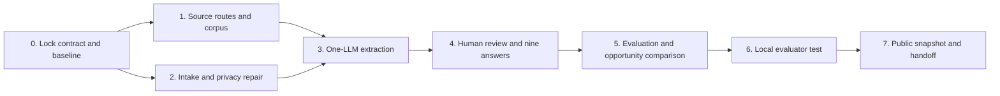

# Phase-wise implementation plan — Groww SIP AI Discovery Engine

**Version:** 1.0, 4 November 2026

**Inputs:** [Problem Statement.md](Problem%20Statement.md) and corrected [architecture.md](architecture.md).

**Product shape:** one LLM, a simple permitted-source intake and analysis pipeline, deterministic counts, human review, nine evidence-bounded answers, and an evaluator-facing prototype. **No multi-agent system.**
**Deadline:** 9 November 2026, 3:59 PM IST. All dates below use IST.

## 1. What “done” means

By the submission handoff, the **AI discovery engine** should have a working link and a two-minute evaluator path. It should explain what it examined, distinguish real from excluded or simulated material, show which of the nine questions have supported answers, let the evaluator open original sources behind claims, and compare candidate opportunity areas without deciding the final product solution. At least one allowed new sample should produce a structured, uncertainty-aware classifier result **if** the live quality gate passes; otherwise the tester must show an explicit, safe unavailable state and the limitation must be disclosed. The research evidence log and a one-slide workflow explanation must match what actually ran.

“Done” does **not** mean every source yielded data, every question has a substantive answer, Groww's 12-month metric was measured, or an investor problem was validated. Those claims need evidence this engine may not have. The later target-segment choice, 5–6 interviews/approved alternative, customer MVP, three-user test, metrics and final deck remain separate project work.

### Success evidence to show, not merely assert

- A dated register for **all seven named source families**, with access decision, actual collection route, counts or zero, and any restriction.
- A real corpus with source links and a screening funnel: `screened → admitted → MF-SIP relevant → direct/adjacent/unknown → human-reviewed`; every number has a unit and denominator. No mock account contributes to these counts.
- One visible before/after example showing original account link → de-identified extracted event → reviewer decision → question answer or honest unknown.
- Nine question views, source-backed text where possible, counterexamples and clear gaps where not.
- An opportunity comparison with evidence, rival and next test, with no prevalence claim or automatic winner.
- A hand-labelled golden set of about 20 permitted items with label provenance; actual agreement/error numbers and 2–3 **real** AI corrections if they occur. Do not invent corrections to meet the brief.
- A locally tested evaluator flow, then a public link whose snapshot and tester match the local approved state.

## 2. Project rules carried into every phase

1. **No investment advice, specific fund/stock recommendation, fear, FOMO or urgency nudges.** An informed pause may be appropriate.
2. **One model, no autonomous agents.** The LLM extracts and drafts; code validates/counts; the researcher reviews and decides. Use the user's free-tier Groq configuration with no paid fallback. Do not repeat billing-confirmation requests.
3. **Source permission precedes collection/model use.** A URL, API key or spreadsheet does not grant rights. Record all seven families; admit only material from a source-specific permitted route. App Store and Reddit stay unavailable under the currently recorded routes unless valid permission changes.
4. **Real, context, survey and synthetic lanes are separate.** The nine written survey responses are secondary triangulation. Company documentation and expert articles are context. Synthetic stories are engineering fixtures, never research findings or corpus volume.
5. **No fabricated cohort fit.** First-ever MF, first SIP on Groww, first-year timing and successful instalment are distinct facts; each may be unknown. One cancelled SIP does not prove investor-level inactivity.
6. **Quantification uses source roots and denominators.** One thread is not many independent confirmations. Public-post counts describe only this selected corpus, never Groww-user prevalence or the NSM.
7. **Stop a broken path, not the project.** If a source is blocked or the model quality gate fails, report the actual state and continue with permitted sources or reviewed manual evidence. Do not pad a gap with mock content.

## 3. Starting point on 4 November

The repository already has a React/Vite interface, a local Node server, CSV intake, SQLite store, normalization/deduplication helpers, source-use checks, draft extraction contracts, evaluation helpers, a snapshot path and a Cloudflare Worker skeleton. They are **parts to inspect and reuse**, not proof of a working research engine. Current code holds `/api/batch` and `/api/classify` locally and the Worker live classifier; the legacy full-packet route is held. The displayed seed rows are not a finished, reviewed corpus and the nine narrative answers are not yet produced. The corrected architecture is the target; every phase below must report actual implementation and actual counts.

Local Git commits mark reversible checkpoints. Raw source text, survey material, local SQLite and API keys stay in ignored local storage. No GitHub push or Cloudflare publish occurs before the local experience is working and reviewed, per the user's sequence.

## 4. Dependency map

Source research and synthetic software tests may progress in parallel. **Narrative answers wait for real, reviewed extraction.** Deployment waits for a reviewed local journey and privacy-safe snapshot.

## 5. Phases, outputs and exit gates

### Phase 0 — Lock the build contract and inspect the baseline (4 November)

**Decision served:** exactly what the engine should answer and what existing code can safely be reused.

**Work:** treat [Problem Statement.md](Problem%20Statement.md) as the requirement, [architecture.md](architecture.md) as the one-LLM design, and the original brief as the metric/source of deliverables. Inspect existing routes, data schema, local UI and known failed model paths. Freeze the nine answer template, core extraction fields, source-lane statuses, privacy allowlist and publication criteria. Mark older multi-agent language and held experiments as history, not current scope. Verify the actual local seed count rather than carrying a number forward from memory.

**Output:** decision log, gap list, versioned contracts and a plain-language “what the engine does” statement on the home screen. **Exit gate:** every required output maps to a data field, screen and quality check; the currently unrun parts are named. **Current status (4 November): complete locally.** The measured baseline, decision log, gap list, source status, answer format and public snapshot release rule are in [PHASE_0_CONTRACT_2026-11-04.md](PHASE_0_CONTRACT_2026-11-04.md). The local UI now states the research job and its dated seed baseline. Phase 1 has since run one permitted forum intake; live model extraction, independent evaluation and public publication remain unrun.

### Phase 1 — Build a permitted, source-linked corpus (4–6 November; highest research risk)

**Decision served:** do we have enough *actual* user voice to answer each question, and where are the gaps?

**Work:** make a query queue by `question × first-year window × reported state`. Seek start, ordinary continuation, changed amount, failed payment, manual recovery, informed pause and uncertainty; include non-complaint language. For each of the seven named families, check the original source terms and route, then record one of `admitted`, `route_unresolved`, `restricted`, or `no_relevant_yield`. Use bounded authorised collection/export or manual source-linked intake where permitted; no cross-site crawler or scraping around restrictions. Do not treat a link-only lead as analysed text. Capture a stable locator, date/unknown, speaker role and original URL; reject/redact personal identifiers before local storage. Keep company/industry/expert context and nine survey responses in separate lanes.

**Priority:** source families with both permitted access and first-person event yield. The seven-family register is required; equal item volume from every family is not. The earlier 100–150-item idea is a **stretch collection target only if source rights and yield permit it**, not a promise or a reason to invent data. Record actual `seen, imported, duplicate, excluded, user_voice, context, direct, adjacent, unknown` counts after every run. Seek contrasting continuers and interrupted/recovered accounts, but do not promise a first-year Groww month-12 outcome that public posts may not show.

**Output:** dated source register, collection log, local privacy-screened source files, source-fit audit and coverage matrix for Q1–Q9. **Exit gate:** at least one real permitted source path works end to end, each admitted item has a usable locator and permission basis, and blocked lanes appear as zeros with reasons. If target-fit yield is thin, continue with a truthful gap; do not hold the entire software build for a round number.

**Current status (4 November): source-intake exit gate met locally, research sufficiency not met.** The [Phase 1 report](research/phase_one_2026-11-04/PHASE_1_REPORT.md) records one manual, permitted TradingQ&A route: 20 post units screened, 15 source-linked excerpts imported, 5 excluded, 0 duplicate attempts and 0 direct Groww first-year matches. Its initial screen marked all 15 adjacent; the [Phase 2 source audit](research/phase_two_2026-11-04/PHASE_2_REPORT.md) corrected one to unknown platform, leaving 14 adjacent. The report includes the seven-family status, collection log and Q1–Q9 candidate coverage. No narrative answer or target segment is validated by this intake.

### Phase 2 — Normalize, deduplicate and make the evidence funnel correct (5–6 November)

**Decision served:** can counts and source drill-down be trusted before any AI prose appears?

**Work:** repair/verify CSV validation, private-data rejection, source-family mapping, canonical URLs, stable post/review IDs, repeated text fingerprints and dependent thread grouping. Preserve separate `source_item_id` and `source_root_id`; flag possible cross-posts for review instead of silently merging. Code MF-SIP relevance and direct/adjacent/unknown first-year fit without guessing. Store rejected/pending reasons, not raw private text. Display `screened = rejected + pending + admitted` with a declared treatment for duplicates; keep user voice, context and synthetic units separate. Provide source links behind funnel counts.

**Output:** reproducible intake report, deduplicated local ledger, and a readable Sources page that explains its numbers. **Exit gate:** fixture checks for duplicate threads, false stock-SIP matches, mixed instruments, malformed URLs/dates and PII; a manual audit of the first real batch; every displayed count reconciles to the ledger. A “22 inputs” total without the breakdown is not accepted.

**Current status (4 November): completed locally for source accounting, with explicit evidence gaps.** The [Phase 2 report](research/phase_two_2026-11-04/PHASE_2_REPORT.md) and `node scripts/reconcile-phase-two.mjs` reconcile 42 tracked decisions as 17 admitted, 20 pending and 5 excluded. The Sources view exposes links, locators and separate item/root keys. Five older pending rows share two unresolved locators; they were not silently deduplicated or treated as separate people. The first real batch received an assistant source audit, not independent Fellow validation. No AI answer or target opportunity was chosen.

### Phase 3 — Make one-LLM extraction reliable enough for proposals (5–7 November)

**Decision served:** can the free model extract explicit SIP facts while preserving uncertainty?

**Work:** use one Groq Free model through the existing provider adapter. First run **synthetic** edge cases only: negation, Hinglish, one of several SIPs stopped, hypothetical versus actual action, commenter versus original poster, recovery, informed pause, unknown tenure, prompt injection and private details. Keep the request small and strict: MF-SIP relevance, fit, journey stage, initiating `metric_node`/`exit_form`, action status, reported reason, actor attribution if explicit, final outcome and source anchors. Do not send the old oversized full Tier B packet. Log actual tokens, latency, finish reason, 429/truncation, structure failures and rejected fields, without raw source text. Stop on a failed structure gate, repair once from diagnostics, then retest transparently.

When the structure works, run a **small permitted real pilot** and compare proposals with originals before scaling. For selected full narratives, the same LLM may do a second short episode pass; it is optional depth, not a separate agent. A short review is never expanded into an invented chronology. `unknown` stays distinct from model failure. No paid fallback or uncontrolled retry.

**Output:** versioned prompt/schema, proposal records, per-call telemetry, human-visible source anchors and an error report. **Exit gate:** strict schema/anchor/privacy checks pass on fixtures; real proposals are clearly labelled **unreviewed**; known failures are reported. Passing a synthetic test alone does not make an insight valid.

### Phase 4 — Human review, deterministic counts and the nine answers (6–7 November)

**Decision served:** which questions can the admitted corpus answer, and how strongly?

**Work:** the researcher opens originals and accepts/corrects/rejects material labels. For each actual episode separate `stated reason`, `supported situation` and `driver hypothesis`; keep expected next contribution apart from reported result. Count source roots in code, not in the LLM. Build one evidence packet per question from accepted, rights-cleared records and a computed denominator. The one LLM may draft a short answer from that packet; code validates IDs/numbers and a person approves the wording. Each answer includes a direct point, linked accounts, source mix and count, a counterexample/rival, unknown and next discriminating question.

**Coverage-specific rules:** Q2 needs within-person before/after; Q4 frequency requires explicit cadence; Q7 cannot claim to observe silent drop-offs; Q8 never infers age/income/source of money; Q9 cannot turn repeated complaint words into a verified unmet need. Answers remain `insufficient evidence` where appropriate. The engine does not choose a segment, cause or feature.

**Output:** nine question cards and inspectable evidence ledger. **Exit gate:** all nine cards render without filler, all material claims resolve to accepted source IDs, counters and missingness are visible, and computed counts reconcile. At least one question is traced end to end in a manual walkthrough; report how many questions are supported versus open.

### Phase 5 — Compare opportunities and evaluate AI quality (7–8 November)

**Decision served:** what candidate problems merit later research, and can the AI output be trusted as a proposal?

**Work:** the researcher names candidates only from accepted evidence. Compare each by target fit, independent source breadth, reported consequence/workaround, plausible NSM pathway, existing Groww control, constraint fit, rival and next test. Keep reach as `unknown` unless a defensible proxy exists; never rank automatically. Prepare a hand-labelled set of about 20 **real, permitted** varied items. Record whether labels were blind, development-reused or post-AI adjudicated. Compare exact supported fields, unknown preservation, inventions, abstentions and processing failures; report counts before percentages and `K = C + W + A`. Log only genuine model corrections and explanations.

**Proposal gate:** zero severe privacy/advice/fabricated-source/false-exact-cohort errors; explicit-field recall at least 70%; at least 90% of unknown fields remain unknown; at most one whole-item processing failure in ten calls on the frozen check. These are prototype thresholds for proposed extraction, **not** proof that a candidate problem is true. If they fail, simplify/report and do not present the model as validated. Accepted human-reviewed findings may still be shown with their actual provenance.

**Output:** opportunity comparison without score, evaluation report, golden-set provenance, real correction log and AI Evidence Log draft. **Exit gate:** no model-only claim appears as human-verified; strengths, failures, denominators and source mix are explicit. If fewer than about 20 suitable permitted items are available, show the real count and mark the brief's golden-set requirement incomplete rather than filling it with synthetic records.

### Phase 6 — Make the local prototype understandable and test it (8 November)

**Decision served:** can a new evaluator understand the research job and audit an answer within two minutes?

**Work:** simplify the UI to a clear path: `What we are investigating → What sources actually entered → Nine questions → Open one source → Compare candidates → Try a permitted sample`. Replace internal jargon with plain-English labels and show unit/denominator next to counts. Implement a transient paste screen that checks source-use eligibility and PII, calls the one model only if the Phase 5 gate passes, shows `proposal/uncertain`, and stores no pasted text. Add limited safe logging, rate/token caps and kill switch. If disabled or rate-limited, show a genuine fallback; never fake a classification. Check keyboard/phone-sized layout and source links.

**Output:** locally hosted working prototype, screenshots for the deck, manual evaluator walkthrough notes and a list of unresolved issues. **Exit gate:** tests and production build pass; no private data in page/network bundle; a fresh person can explain the engine's purpose, open evidence behind a count and tell what is unknown. User confirms the local version before a GitHub push or Cloudflare deployment.

### Phase 7 — Publish the reviewed snapshot and hand off (8–9 November)

**Decision served:** can the mentor open a safe, truthful, working version?

**Work:** export only accepted, rights-cleared, de-identified fields, source links and approved answers. Scan the snapshot for personal data, raw text, unresolved rights and synthetic leakage. Version the code and safe snapshot in GitHub after local confirmation; deploy the React viewer and Cloudflare Worker. Production exposes read-only research and at most one validated, rate-limited classifier endpoint—no import, review or admin routes. Verify the public URL, all nine question routes, links, source counts, tester/fallback and mobile view. Retain the previous snapshot or deployment for rollback. Put the engine link, one-slide method diagram and accessible AI Evidence Log link into the final submission materials.

**Output:** public test link, deployed version/hash, source snapshot date, verification record, AI Evidence Log and one-slide flow material. **Exit gate:** external user can perform the same two-minute path; public counts equal the approved local snapshot; no secret or raw corpus is deployed. Report any missing source family or unanswered question plainly. This phase does not by itself complete the later user-facing MVP or 10-slide deck.

## 6. Per-phase status report template

At every milestone report, in plain English:

1. **What decision this phase addressed.**
2. **What exists and what actually ran.** Include exact `items, source roots, families, direct/adjacent/unknown, reviewed`, plus model calls/tokens and failures where relevant.
3. **What we learned and the strongest rival explanation.** Separate source observation, researcher inference and unknown.
4. **What remains unrun, blocked or below quality gate.** Do not call it complete because the interface renders.
5. **What the next phase needs from the user**, if anything: source/consent decision, genuine hand labels, local review, API credential, or publication check. Ask only when it becomes necessary; no paid key is required for the planned free path.

## 7. Deadline controls and fallback order

**Protect first:** source integrity, the nine honest answer states, one traceable real episode, human review, evaluation disclosure, local evaluator path, and safe public link. **Trim if time is short:** optional factor fields, extra Tier B depth, secondary filters, extra charts and large-volume collection that does not add target-fit information. Never trim by inventing reviews, mock interviews, causes, model accuracy or source coverage.

If a source route is blocked, keep the lane with `0 analysed / access restricted` and shift time to permitted first-hand sources. If the free model cannot pass structural checks, use clearly marked reviewed manual labels for the research viewer and disclose that live AI classification is disabled; the AI-discovery requirement then remains partly unmet and must be reported rather than disguised. If the public endpoint cannot be made safe by the release gate, deploy the read-only reviewed viewer and explain the tester limitation. If a genuine golden set cannot reach the brief's approximate size, report the shortfall and do not relabel synthetic fixtures as human evidence.

## 8. What follows after this plan

The discovery engine helps identify research-worthy situations; it cannot decide the final target segment or prove a root cause. After reviewing its outputs, the PM still needs the brief's metric decomposition, primary research, problem definition, distinct eval-gated user MVP, three-user task test, solution metrics, risk analysis and deck. This plan stops at the **engine deliverable and its evidence handoff** so later work is not silently treated as done.
