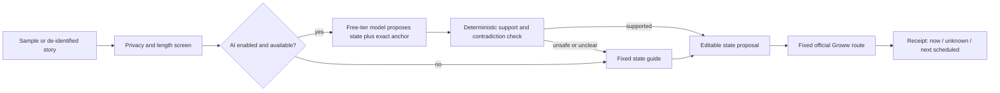

# MVP architecture and data flow

## Components

The Worker receives the story transiently. It does not store text or log it in the app. The model returns only a finite state and exact substring from the story; it cannot generate links, recommendations or actions. Code checks the substring and contradictory cues, then supplies approved wording and one official Groww URL. A user correction is a *self-report*, not a verified transaction. The next-cycle checkpoint is a separate optional self-report in the browser session only; refreshing clears it.

## State contract

`not_due | unpaid_unclear | failed_reported | debited_processing | completed_reported | intentional_pause | unknown`. The state describes what the person reported. It never describes the account's confirmed final state. A completed-by-report state still asks for Groww order verification. A one-time payment or Pay Now attempt is this-cycle context and cannot be interpreted as next-cycle restoration. Multiple SIPs are not collapsed to a lost investor. Unknown is an acceptable output.

## Runtime and release

Static HTML/CSS/JS is served with the existing Cloudflare Worker. `POST /api/sip-status` screens input, makes at most one free-tier model request if enabled, and applies code validation. Model errors, rate limits or the kill switch use the fixed fallback. No admin or write routes are public. The published discovery engine and this MVP are separate views even if served by the same Worker. The public AI route is disabled until independent quality review meets the gate in [GOALS.md](GOALS.md).

## Failure handling

Block sensitive input before the model call; never echo it in an error. Mixed debit and failure, missing anchor, negation, invented cause, or invalid model JSON becomes unknown. Do not encourage a second payment while bank debit/finality is unresolved. If the model is unavailable, the fixed guide remains usable. Keep the current official Groww links under review; documentation may change.
