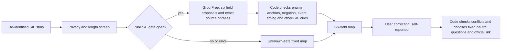

# Continuity Map: shipped data flow

**9 November 2026.** This extends the earlier single-state receipt architecture without replacing its baseline.

The six fields are investor intent, bank debit, focal Groww SIP order, this-cycle workaround, following scheduled SIP, and another SIP. This is a **two-due-event, multi-actor map**, not an account-status lookup. The model cannot choose a payment instruction, official URL, fund, amount or actor fault. Missing information remains `unknown`; the UI labels corrections as self-reported. Raw descriptions are processed transiently and not persisted by the application.

The public Worker serves `/sip-map.html`, `POST /api/sip-map` for the fixed route, and `POST /api/sip-map-propose` for bounded AI proposals. The current public kill switch is on. The code path made one successful synthetic Groq Free call; the independent real-item gate in [CONTINUITY_MAP_EVAL.md](CONTINUITY_MAP_EVAL.md) remains unmeasured. Thus mentors can test the fixed map and fallback now, while the AI proposal is built but held. Deployment does not imply an outcome, model-quality or user-test result.

The experiment compares current Groww help, the older fixed receipt, and this map on the **same** de-identified payment-understanding task. AI is retained only if it adds correct understanding of mixed or negated descriptions without increasing severe errors or correction burden. Another successful SIP remains separate from the focal failed plan, and an informed pause remains a valid investor outcome.
